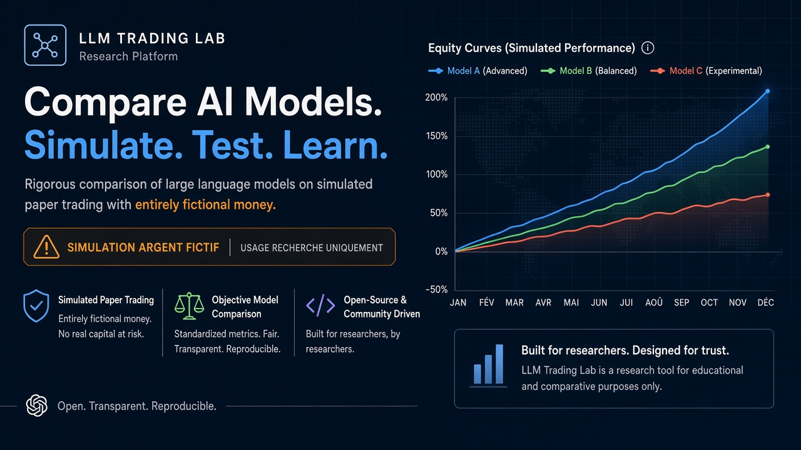
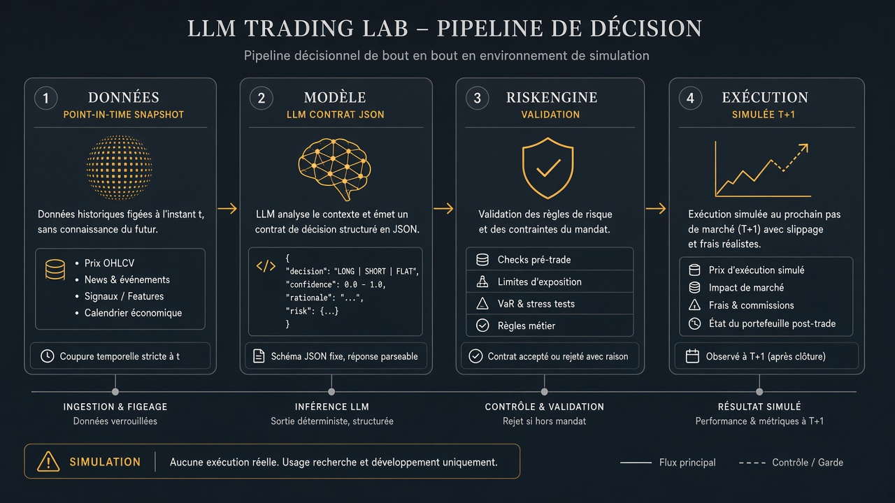
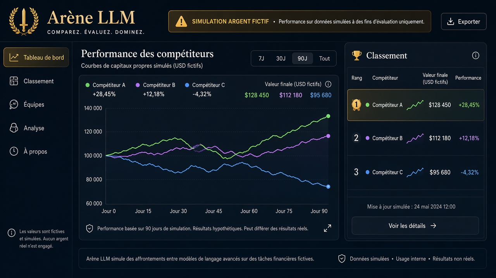
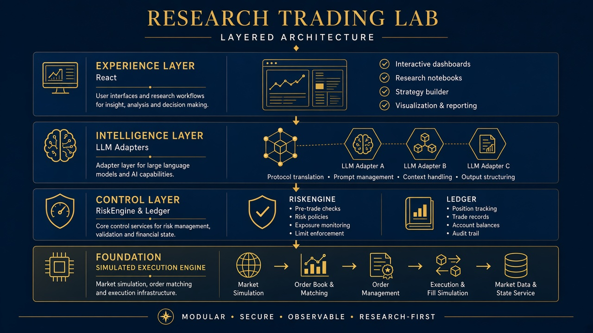

<p align="center">
  
</p>

<h1 align="center">LLM Trading Lab</h1>

<p align="center">
  <em>Un protocole d’évaluation — pas un terminal de trading.</em><br/>
  <strong>Campagnes simulées · journal auditable · argent entièrement fictif</strong>
</p>

<p align="center">
  <a href="LICENSE"></a>
  
  
  
</p>

<p align="center">
  <a href="docs/README.md">Documentation</a> ·
  <a href="docs/GETTING_STARTED.md">Démarrage</a> ·
  <a href="docs/ARCHITECTURE.md">Architecture</a> ·
  <a href="docs/marketing/faq-public.md">FAQ</a> ·
  <a href="docs/marketing/roadmap.md">Roadmap</a>
</p>

---

> **SIMULATION — ARGENT FICTIF** — Aucun ordre réel, aucun conseil en investissement.  
> [Avertissements et périmètre légal](docs/marketing/disclaimer.md)

---

## En bref

On ne demande pas à un LLM s’il « bat le marché » dans le vide.

On lui impose **le même instant**, **les mêmes données**, **les mêmes plafonds de risque** — puis on mesure rendement, drawdown, fiabilité et **coût API**, séparément du PnL fictif.

| | |
|:--|:--|
| **Question** | Quels modèles et architectures décident le mieux *après* risque, frais simulés et coût IA ? |
| **DEMO** | Sans clé payante — agents déterministes, seed reproductible |
| **Licence** | MIT |

<p align="center"><strong>Fournisseurs LLM (adaptateurs — équité expérimentale)</strong></p>

<p align="center">
  
  &nbsp;&nbsp;
  
  &nbsp;&nbsp;
  
  &nbsp;&nbsp;
  
  &nbsp;&nbsp;
  
</p>

<p align="center">
  <sub>Démo active par défaut · clés API uniquement côté serveur · modèles vérifiés selon vos accès</sub>
</p>

---

## Comment ça se déroule

<p align="center">
  
</p>

<p align="center"><em>Snapshot point-in-time → contrat JSON → RiskEngine → exécution simulée au lendemain (open).</em></p>

Trois vues complémentaires :

| | |
|:---:|:---|
| <br/>**Arène** | Courbes alignées, classement, coût IA par concurrent — un seul moteur par tournoi. |
| <br/>**Couches** | UI, intelligence, contrôle. Le modèle ne touche jamais le registre ni les clés broker. |

---

## English

**LLM Trading Lab** is an open research stack for **controlled simulated portfolio decisions**: shared data access, deterministic risk checks, decision-time alignment, API budget caps. Fictional capital only. DEMO runs without paid keys.

---

## Capacités clés

**Arène** — concurrents isolés, courbes comparables.

**Modes** — `DEMO` · `BACKTEST` *(exploratoire)* · `PAPER_FORWARD` *(préparé)*.

**Contrat JSON** — poids cibles validés ; abstentions et échecs conservés.

**RiskEngine** — plafonds, instruments, fraîcheur des données ; indépendant du LLM.

**Exécution** — moteur local canonique, open T+1, hypothèses de frais déclarées.

**Rapports** — HTML / JSON avec métadonnées de reproduction.

→ [Matrice fonctionnelle](docs/marketing/feature-matrix.md)

---

## Démarrage (Docker)

```powershell
git clone https://github.com/<VOTRE_ORG>/llm-trading-lab.git
cd llm-trading-lab
copy .env.example .env
docker compose up --build
```

| Service | URL | Accès |
|---------|-----|--------|
| Interface | http://localhost:5180 | — |
| API | http://localhost:8808/docs | `demo` / `demo` |

---

## Développement local

Guide détaillé : [docs/GETTING_STARTED.md](docs/GETTING_STARTED.md).

```powershell
# API
cd backend
python -m venv .venv && .\.venv\Scripts\pip install -r requirements.txt
python -m scripts.generate_demo_parquet
$env:PYTHONPATH="."; $env:DATABASE_URL="sqlite+pysqlite:///c:/project/traiding/data/lab.db"
$env:TRADING_MODE="DEMO"
.\.venv\Scripts\uvicorn app.main:app --host 127.0.0.1 --port 8808

# UI
cd frontend && npm install && npm run dev -- --host 127.0.0.1 --port 5180
```

**Parcours** : Campagnes → exécuter un pas → Arène → Rapports.

---

## Tests & CI

```powershell
cd backend
$env:PYTHONPATH="."; $env:DATABASE_URL="sqlite+pysqlite:///../data/test.db"
python -m pytest -q tests
```

Workflow : `.github/workflows/ci.yml`.

---

## Configuration LLM

Variables **serveur uniquement** (`.env`, hors Git) :

`OPENAI_API_KEY` · `ANTHROPIC_API_KEY` · `GOOGLE_API_KEY` · `OLLAMA_BASE_URL`

Paper optionnel : `ALPACA_PAPER_*` — jamais mélangé au classement du simulateur local.

`TRADING_MODE` : [méthodologie](docs/methodology.md).

---

## Documentation

**Technique** — [repository-review](docs/repository-review.md) · [methodology](docs/methodology.md) · [data-integrity](docs/data-integrity.md) · [execution-assumptions](docs/execution-assumptions.md) · [ARCHITECTURE](docs/ARCHITECTURE.md)

**Publication** — [overview](docs/marketing/overview.md) · [pitch](docs/marketing/elevator-pitch.md) · [github-launch](docs/marketing/github-launch.md) · [disclaimer](docs/marketing/disclaimer.md)

**Réseaux sociaux** — image : [og-social-preview.jpg](docs/assets/og-social-preview.jpg)

---

## Contribuer

[CONTRIBUTING.md](CONTRIBUTING.md) · [SECURITY.md](SECURITY.md) · [CODE_OF_CONDUCT.md](CODE_OF_CONDUCT.md)

---

## Crédits

- [lightweight-charts](https://github.com/tradingview/lightweight-charts) (Apache-2.0, TradingView)
- Icônes LLM : identification des fournisseurs supportés ; marques déposées de leurs titulaires — voir [docs/assets/icons/README.md](docs/assets/icons/README.md)

---

## État V0.1

| Livré | Prochainement |
|-------|----------------|
| DEMO bout-en-bout, arène, rapports | LLM commerciaux branchés |
| `local_canonical`, 12 tests métier | Campagne 8 semaines planifiée |
| Kit marketing & visuels | Architecture B multi-agents |

[Feuille de route](docs/marketing/roadmap.md)
