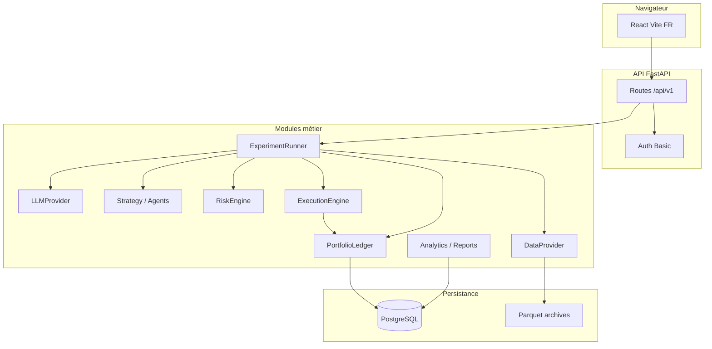

# Architecture

## Services nommés

| Service | Rôle |
|---------|------|
| `DataProvider` | Barres, snapshots `available_at`, hash paquet |
| `LLMProvider` | Inférence structurée (DEMO = déterministe) |
| `Strategy` | Architecture A : poids cibles |
| `RiskEngine` | Validation indépendante |
| `ExecutionEngine` | Fills simulés (`local_canonical`) |
| `PortfolioLedger` | Cash, positions, frais |
| `ExperimentRunner` | Cycle décision → ordres → équité |

## Flux décision (résumé)

1. Construire snapshot **≤ as_of**.
2. Obtenir `DecisionContract` (ou échec journalisé).
3. `RiskEngine.validate_decision`.
4. Si OK : cibles → quantités → ordres idempotents → fills T+1.
5. Snapshot équité + rapport.

## Déploiement

- **Docker Compose** : `api`, `worker`, `postgres`, `redis`, `frontend` (nginx).
- Ports hôte par défaut : UI **5180**, API **8808**.

Voir [repository-review.md](repository-review.md) pour les choix de moteur et dépendances externes.
