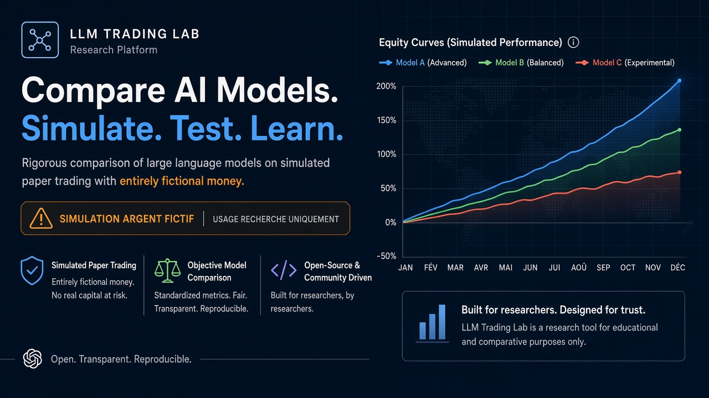
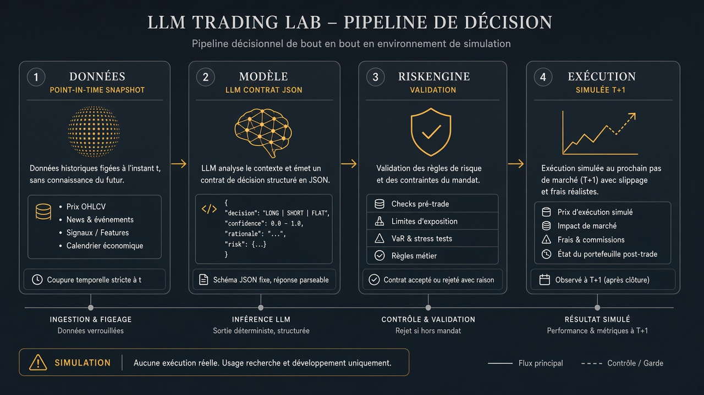
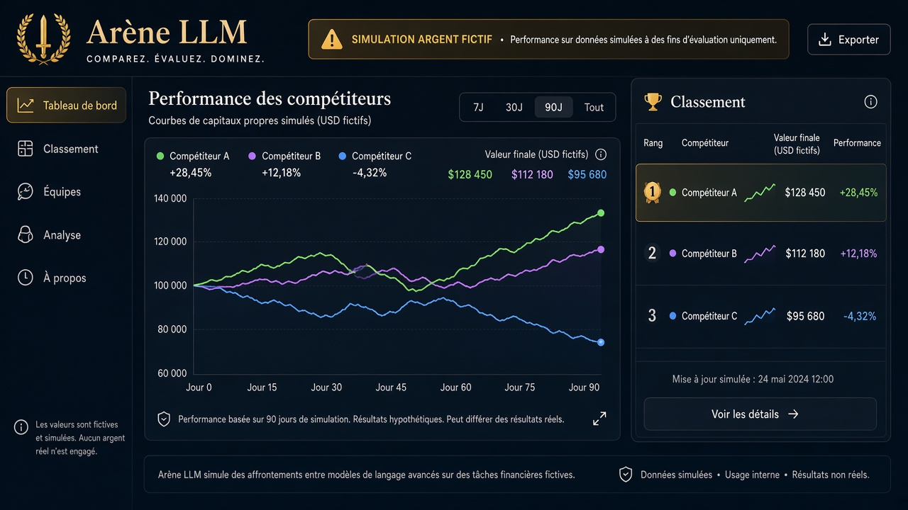
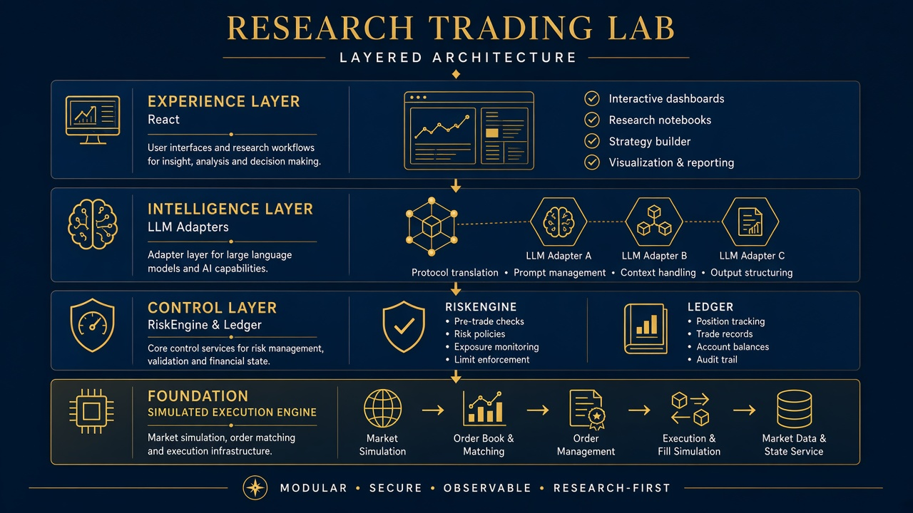

# Vue d’ensemble

  

## Une phrase

**Même protocole, plusieurs intelligences** — allocation simulée, risque codifié, coût IA visible, capital fictif.

---

## Le constat

Les démos « LLM trader » souffrent souvent du même déficit : un chiffre mis en avant, peu de traçabilité, des backtests opaques, et le **coût d’inférence** traité comme un détail.

Ce laboratoire inverse la priorité :

1. **Reproductibilité** — snapshots hashés, versions de prompt, commits logiciels.
2. **Séparation des métriques** — PnL fictif ≠ dépense API réelle.
3. **Contrôle** — `RiskEngine` en amont de tout fill simulé.

---

## Fournisseurs LLM

  
  
  
  
  

| Fournisseur | V1 | Rôle |
|-------------|-----|------|
| Démo déterministe | ✅ | Zéro clé, enseignement, CI |
| OpenAI | Configuration | Contrat JSON structuré |
| Anthropic | Configuration | Idem |
| Gemini (Google) | Configuration | API Google AI |
| Local (Ollama) | Configuration | Modèles self-hosted |

Expérience principale : **même architecture, même prompt, même budget plafond** par concurrent.

---

## Visuels du protocole

### Chaîne de décision

*Données admissibles à `as_of` → proposition de poids → validation → ordres idempotents.*

### Arène

*Comparaison sur calendrier et moteur communs — sans mélange Alpaca / simulateur local.*

### Architecture en couches

*Le LLM propose ; le code calcule, valide, exécute, comptabilise.*

---

## Statut V1

| Capacité | |
|----------|---|
| Campagne multi-concurrents | ✅ DEMO |
| Arène & rapports | ✅ |
| Backtest LLM | ✅ exploratoire |
| Paper 8 semaines | 🔧 préparé |
| Multi-agents (B) | 🔧 roadmap |
| Trading réel | ❌ hors périmètre |

---

## Publics

**Chercheurs** — ablations, incidents conservés.  
**Quants** — intégrité temporelle, ledger `Decimal`.  
**Formateurs** — démo hors ligne.  
**Produits LLM** — preuves sous contraintes.

---

## Aller plus loin

- [Démarrage rapide](../GETTING_STARTED.md)
- [Disclaimer](disclaimer.md)
- [Roadmap](roadmap.md)
- [Positionnement](positioning-vs-alternatives.md)
